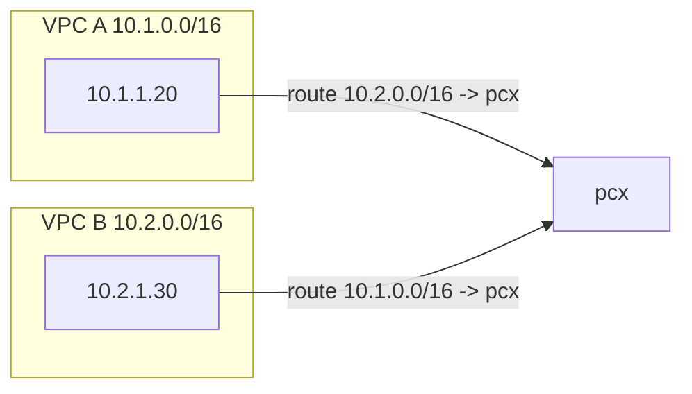
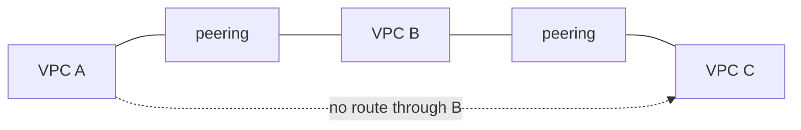
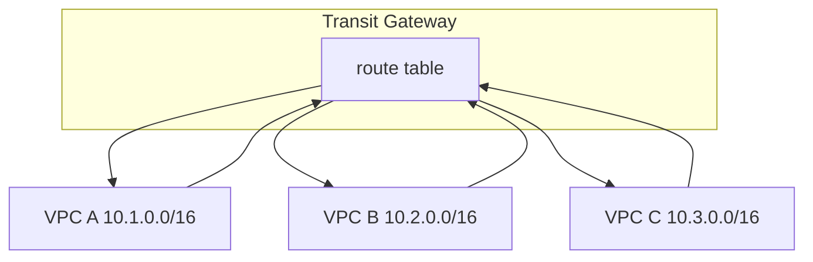

# L3 Private Connectivity in AWS

Two networks are privately connected at layer 3 when each one has a route to the other's CIDR and the packets stay on the AWS network. The instances keep their private IPs. Nothing in the path assigns a public address or sends the packet through an internet gateway.

A VPC already does this for its own subnets. Every route table has a local route, such as `10.1.0.0/16 -> local`, so `10.1.1.20` can reach `10.1.2.30` with no extra gateway. A second VPC is a second network. Its CIDR is invisible until you add a route whose target is a private link to that VPC.

AWS gives you two of those links:

*   **VPC peering** connects one pair of VPCs.
*   **Transit Gateway** is a regional router that many VPCs attach to.

Both move IP packets between CIDRs. [AWS PrivateLink](../aws/networking-basics.md), already covered with VPC endpoints, does a different job: it publishes one service into another VPC and leaves the two CIDRs unrouted.

---

## 1. VPC Peering

A peering connection (`pcx-...`) is a direct route between two VPCs. The VPCs can be in the same account or different accounts, and in the same region or different regions. One side requests the connection. The other side accepts it. Until both route tables point at the peering, the connection exists and no packets flow.

Take `10.1.1.20` sending to `10.2.1.30`:

1.  The route table in VPC A matches `10.2.0.0/16` and selects the peering connection. The local route `10.1.0.0/16` does not match this destination.
2.  The packet crosses the peering on the AWS network. The source and destination IPs stay `10.1.1.20` and `10.2.1.30`.
3.  VPC B delivers it to the instance. The security group on `10.2.1.30` has to allow that source, and the network ACL on its subnet has to allow it too.
4.  The reply needs the opposite route, `10.1.0.0/16 -> pcx` in VPC B. A route in only one direction is enough for the first packet to arrive and not enough for TCP to complete.

Security groups stay stateful across the peering, so an allow rule for the inbound connection covers the return traffic. In the same region a rule can name a security group in the peer VPC. Across regions the rule has to name a CIDR, because a security group ID in another region is not a valid source.

Peering does not share DNS by itself. Each VPC still resolves names with its own resolver. You can turn on DNS resolution across the peering so a public hostname in the peer VPC resolves to that instance's private IP. A private hosted zone is shared by associating the zone with the other VPC.

### What peering refuses to do

**The two CIDRs cannot overlap.** Longest-prefix match has to choose one next hop for a destination. If both VPCs are `10.0.0.0/16`, a route to the peer would be the same prefix as the local route, and the local route wins inside each VPC. Neither side can address the other.

**A VPC cannot forward packets that arrived over peering.** The VPC router delivers a peered packet to a local ENI. It will not send that packet out another peering, a Transit Gateway, a VPN, Direct Connect, or an internet gateway. This is the edge-to-edge rule.

VPC A peered with VPC B, and VPC B peered with VPC C, does not let A reach C. B is not a router for them. Every pair that should talk needs its own peering and its own routes, which is a full mesh once you have more than a few VPCs.

### Where the packet is limited

Peering adds no bandwidth cap of its own. Throughput is the limit of the instance or the load balancer at each end. Same-AZ traffic over peering is not billed as data transfer. Cross-AZ and cross-region traffic is. Cross-region peering stays on the AWS backbone.

---

## 2. Transit Gateway

A Transit Gateway is a router you attach networks to, in one region. Each VPC attachment lands in one or more subnets of that VPC, one per Availability Zone you want the gateway to use. VPN and Direct Connect attachments use the same gateway, so this is also where an on-premises network joins the AWS ones. Two regions are connected by peering the gateways, not by turning a VPC into the path between them.

Packets that arrive on an attachment are forwarded by the route table that attachment is associated with. Propagating an attachment into a route table advertises that attachment's CIDR there.

| Idea | What it decides |
| :--- | :--- |
| **Association** | Which route table forwards packets arriving from this attachment. An attachment has one. |
| **Propagation** | Which route tables learn this attachment's CIDR. An attachment can propagate to several. |

One shared route table, with every VPC associated to it and propagated into it, gives every VPC a route to every other VPC. That is the transitivity peering withholds. The gateway is the router, so the edge-to-edge rule on a VPC never comes into play.

Separate route tables are how you keep networks apart. A prod attachment associated with a route table that has no route to the dev CIDR cannot reach dev, even though both are attached to the same gateway.

Inside VPC A the route is `10.2.0.0/16 -> tgw-...` and `10.3.0.0/16 -> tgw-...`. The gateway's route table sends `10.2.0.0/16` out the VPC B attachment. The return route has to exist in VPC B, same as with peering.

The gateway is an extra hop, so latency is higher than a direct peering. You also pay for each attachment and for the gigabytes the gateway processes. For two VPCs that only need to reach each other, peering is the smaller link. The gateway earns its place when many VPCs, accounts, or an on-premises network share one routing domain, or when you need some of those networks kept off each other.

---

## 3. PrivateLink is a service, not a network join

An interface VPC endpoint puts an ENI in the consumer VPC and gives it a private IP from the consumer subnet. Clients send traffic to that IP. PrivateLink carries the connection to a Network Load Balancer in the provider VPC.

The consumer route table gains no route to the provider CIDR. The provider route table gains no route to the consumer CIDR. Only the ports on the published service are reachable, and the two CIDRs may overlap because neither side routes to the other one. That is the right link when another team, or another company, should call one service and should not be able to address the rest of the network.

---

## Choosing the link

| | VPC peering | Transit Gateway | PrivateLink |
| :--- | :--- | :--- | :--- |
| What gets connected | Two VPC CIDRs | Many networks through one router | One service |
| Routes installed | Peer CIDR on each side | Attachment CIDRs in a TGW route table | None for the other network |
| Overlapping CIDRs | No | No, without NAT in front | Yes |
| A reaches C through B | No | Yes, if the route table says so | No |
| Typical use | One pair of VPCs | Many VPCs, accounts, or on-premises | Expose a service across a boundary |

---

## What is still outside this note

Overlapping CIDRs can be joined with a private NAT gateway in front of the transit path. Cross-region designs add gateway peering and the way DNS follows the packet. Both sit on top of the routes above.
