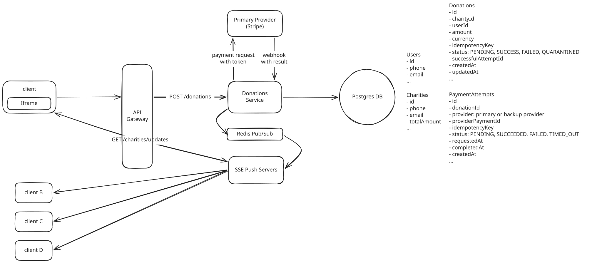

# Payment System

**What is a Donation Service?**

A donations website is a short-lived fundraising platform, usually a 24 to 48 hour event, where people browse a fixed list of charities, contribute money through a third-party payment gateway, and watch live totals climb for each cause.

**Key Focus Areas**

- Idempotency: prevent double charges
- Fan out: For watching live totals climbing, fan out lives numbers to 100k viewers
- Audit/Reconcile: can prove every dollar matches the provider's settlement report

---

## Functional Requirements

1. Users can browse the fixed list of participating charities and see each charity’s purpose.
1. Users can donate to a selected charity through a secure third-party payment checkout flow.
1. Users can see each charity’s donation total and progress update live during the event.

---

## Non-Functional Requirements

1. Prevent duplicate charges
1. Throughput: handle peak traffic of about 500 RPS
1. Charity totals should reach viewers within a few seconds, while supporting up to 100,000 connected viewers.
1. The system must keep an auditable record of every donation and payment-provider event so the final totals can be reconciled with the settlement report.
1. CAP: Availability > Consistency; Donations should not fail even if aggregates are eventually updated.


---

## Core Entities

- **User**
- **Charity**
- **Donation**: represents one donor's intended contribution.
- **PaymentAttempt**: one donation may have attempts with more than one provider.

---

## API Design




### 1. Users browse the list of charities

The below is the simple verison(given that there are only 10 fixed charities):

``` json
GET /charities -> 200

{
  "items": [
    {
      "id": "charity_21",
      "name": "Clean Water Fund",
      "description": "Funding clean-water projects.",
      "goalAmount": 2000000,
      "totalDonated": 1250000
    },
    ...
  ],
}
```

If pagination is required:

``` json
GET /charities?page=3&pageSize=10

{
  "items": [
    {
      "id": "charity_21",
      "name": "Clean Water Fund",
      "description": "Funding clean-water projects.",
      "goalAmount": 2000000,
      "totalDonated": 1250000
    }
  ],
  "page": 3,
  "pageSize": 10,
  "totalItems": 100,
  "totalPages": 10
}
```

The client separately opens a one long-lived SSE connection with `GET /charities/updates`, and that connection stays open for fututre total updates:

``` json
GET /charities/updates
Accept: text/event-stream
Authorization: Bearer <JWT>


HTTP/1.1 200 OK
Content-Type: text/event-stream
Cache-Control: no-cache
Connection: keep-alive

event: charity_total_updated
data: {"charityId":"charity_21","totalDonated":1255000,"goalAmount":2000000}
```

### 2. Users donoate to a charity

``` json
POST /donations
Authorization: Bearer <JWT>
Idempotency-Key: <UUID>

{
  "charityId": "charity_21",
  "amount": 5000,
  "currency": "USD",
  "paymentMethodToken": "provider_token" // provider-issued payment token
}

201 Created
{
  "donationId": "don_123",
  "status": "PENDING"
}
```

!!! warning 

    - Your backend must never receive raw card details.
    - Use the same idempotency key when calling the payment provider. 
      - A retry with that key should return the existing donation rather than create or charge a second one.


### 1. Users see each charity’s donation total and progress update live

Use **a snapshot endpoint plus a Server-Sent Events stream**. The snapshot lets a user load the current totals when they open or reconnect, and SSE pushes later changes without polling.

``` json
GET /charities

[
  {
    "id": "charity_21",
    "name": "Clean Water Fund",
    "totalDonated": 1250000,
    "goalAmount": 2000000
  }
]
```

`GET /charities/updates` opens a long-lived SSE connection. The server sends a new event whenever a charity total changes.

``` json
GET /charities/updates
Accept: text/event-stream

event: charity_total_updated
data: {"charityId":"charity_21","totalDonated":1255000,"goalAmount":2000000}
```

---

## High-Level Design


### 1. Users browse the list of charities

skip

### 2. Users donoate to a selected charity through a secure third-party payment checkout flow.

1. User clicks Donate button.
1. Client generates a UUID(idempotency key)
1. Client sends `POST /donations` with `Idempotency-Key`
    - For network fails, the client retries with the same key.
    - If the Donation row matching with the given idempotency key already exists, server returns the existing Donataion id instead of creating another one.
1. The Donations Service first inserts a `PENDING` donation and a `PENDING` paymentAttempt in the DB.
1. It then sends the payment token and the same idempotency key to the primary provider. If the provider accepts the request, the Service stores that provider's payment ID on the paymentAttempt and returns `201 Created` with `PENDING` status to the client. The provider later sends a webhook(`POST /webhooks/stripe`) with the final result.
1. When a successful webhook arrives, the Donations Service verifies it, then makrs the attempt and donation as `SUCCESS` and increments that charity's `totalAmount`.
1. After the transaction commits, it publishes the new total to Redis Pub/Sub so the SSE servers can push it to viewers.


### 3. Users can see each charity’s donation total and progress update live during the event.

The important rule is that the total is published only after the payment is confirmed and the database transaction commits.

1. A payment provider sends a successful webhook to the Donations Service.
1. The service verifies the webhook and finds the matching `PaymentAttempt`.
1. In one Postgres transaction, it marks the `PaymentAttempt` and `Donation` as `SUCCESS`, then increments the charity's `totalAmount`.
1. After the transaction commits, the service publishes `{"charityId":"charity_21","totalDonated":1255000,"goalAmount":2000000}` to Redis Pub/Sub on `charity:charity_21`.
1. Each SSE server subscribed to that channel receives the message and sends it through its existing SSE connections to viewers.
1. Each browser updates the displayed amount and progress bar.

A newly opened or reconnected browser first calls `GET /charities` for the latest snapshot, then opens `GET /charities/updates` for later changes. That matters because Redis Pub/Sub does not save messages for disconnected viewers.