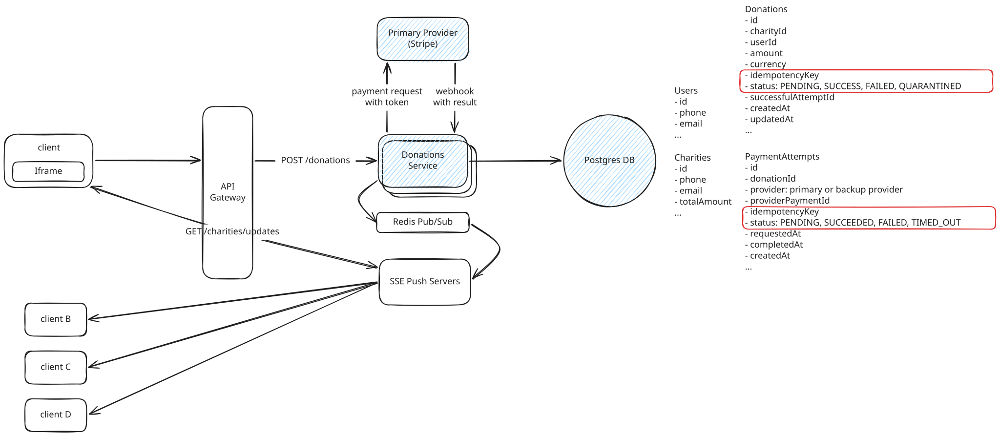
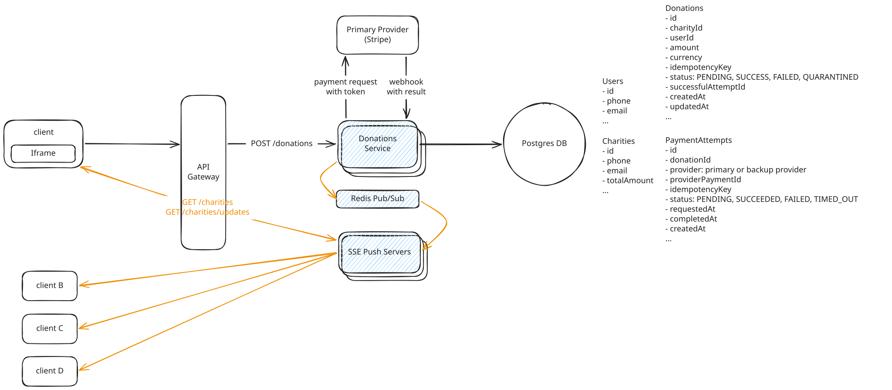
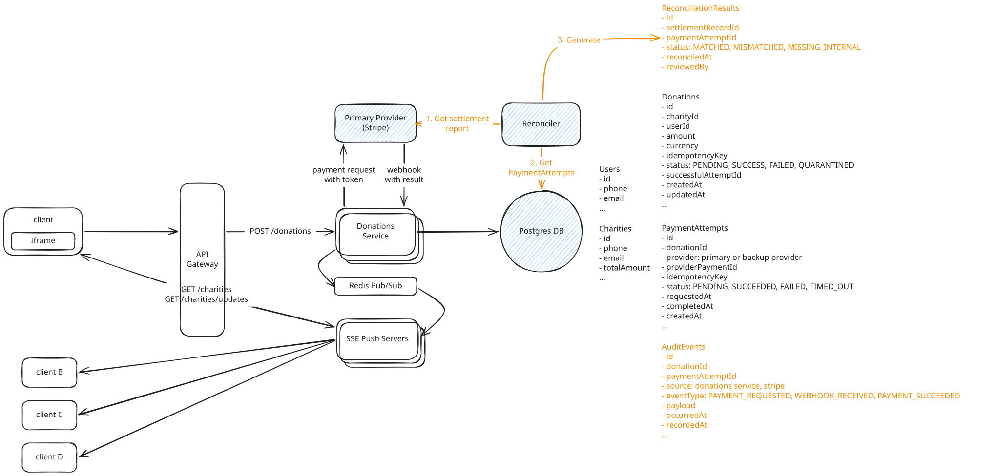
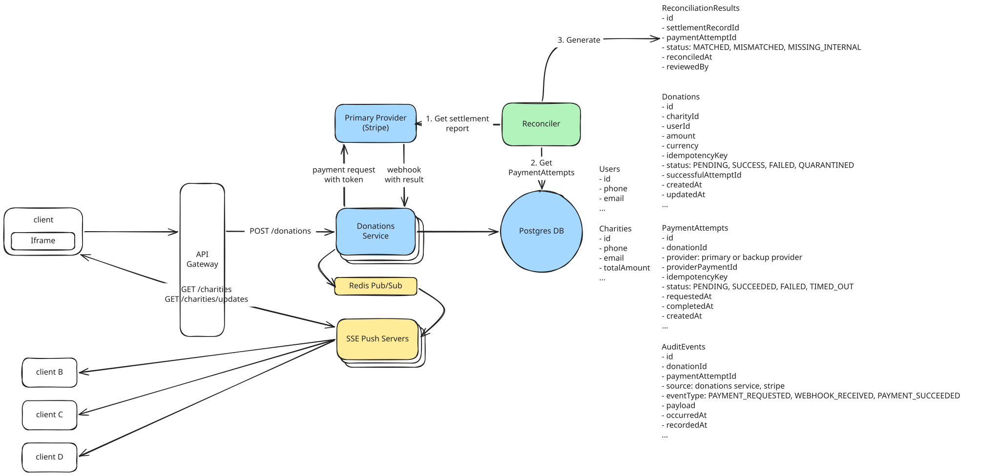

# Donation Service

---
## Deep Dives

### 1. Prevent duplicate charges

- Use an idempotency key for every donation and sending that same key to the payment provider.
- Store the key with the `Donations` row under a **unique constraint**, so a client retry returns the existing donation instead of creating a new charge.

``` bash
Client sends POST /donations with key K
  -> Donations Service creates donation for K
  -> Service sends provider charge request with key K
Client times out and retries with key K
  -> Service finds existing donation
  -> No second provider charge is created
```

- Also record each payment request as a `PaymentAttempt`.
    - If the provider times out, look up the result usking key K before doing anything else.
    - Create a backup attempt only after the primary confirms it has no payment for that key, or confirms the payment failed without charging.
    - If the primary remains unreachable, do not automatically use the backup because that could create a duplicate charge. Escalate it to a reconciliation job or manual review after a defined time window.



### 2. Throughput: handle peak traffic of about 500 RPS

- 500 RPS means up to 500 donation requests per second during the peak. 
- Each request creates one donation and usually one payment attempt. 
- Scale the service horizontally by adding instances, while Postgres handles the transactional writes. 
- The SSE update path is lightweight because it publishes only after confirmed payments.

### 3. Charity totals should reach viewers within a few seconds, while supporting up to 100,000 connected viewers

Use SSE servers behind a load balancer, with Redis Pub/Sub distributing each confirmed charity-total update to every SSE server. Each server holds a manageable share of the 100,000 long-lived browser connections and forwards an update only to its local viewers subscribed to that charity.

For instance, with 20 SSE servers, each holds roughly 5,000 connections. After Postgres commits a confirmed donation, Redis broadcasts one update per SSE server. The servers fan it out over existing SSE connections, which can reach viewers within seconds. On reconnect, a viewer fetches `GET /charities` first because Pub/Sub does not retain missed updates.




### 4. The system must keep an auditable record of every donation and payment-provider event so the final totals can be reconciled with the settlement report

Keep an append-only audit trail for both your own state changes and every event received from the payment provider. `Donations` and `PaymentAttempts` tables hold the current state, while an `AuditEvents` table records immutable facts such as a donation being created, a charge request being sent, a webhook arriving, or a payment succeeding.

For reconciliation, run a scheduled job that imports the provider settlement report and matches each settled payment to `providerPaymentId`. Flag any missing, duplicated, or amount-mismatched records for investigation. The provider event ID unique constraint also makes repeated webhooks safe to process.



### 5. Donations should not fail even if aggregates are eventually updated.

- Keep the donation write strongly consistent in Postgres, then update the aggregate asynchronously from confirmed donation events. 
- If the aggregate updater or Redis is down, the donation still succeeds and viewers may briefly see an older total until the updater catches up.

---

### Final Design


