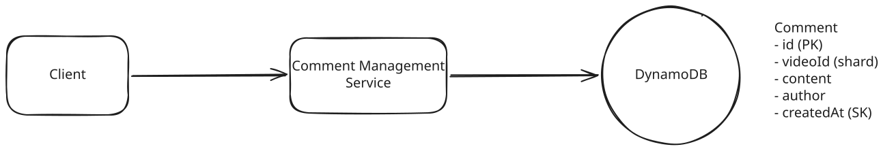

# FB Live Comments

**What are Facebook Live Comments?**

Facebook Live Comments is a feature that enables viewers to post comments on a live video feed. Viewers can see a continuous stream of comments in near-real-time.

**Key Focus Areas**

- Strong consistency for bids -> optimistic concurrency control
- Ensure fault tolerant and durable during the traffic spike -> Kafka
- Broadcast real-time updates -> SSE + Pub/Sub


---

## Functional Requirements

1. Users post comments on a live video feed.
1. Users see new comments being posted while watching the live video.
1. Users see comments made before they joined the live feed.


---

## Non-Functional Requirements

1. Scale to support millions of concurrent videos and thousands of comments per second per live video.
1. availability > consistency, with eventual consistency.
1. low latency, broadcasting comments to viewers in near real-time(<200ms)


---

## Core Entities

- **User**
- **Live Video**
- **Comment**

---

## API Design


### 1. Post comments


``` bash
POST /comments/:liveVideoId
Authentication: JWT | SessionToken
{
    "message": "Cool video!"
}
```

### 2. Fetch past comments

``` bash
GET /comments/:liveVideoId?cursor={last_comment_id}&pageSize=10&sort=desc
```

---

## High-Level Design




### 1. Post comments

1. The client sends the comment to the Comment Management Service via the `POST /comments/:liveVideoId` API endpoint.
1. The Comment Management Service stores the comment in the `Comment` table.

### 2. See new comments being posted

Ensure that when one user posts a comment, all other viewers of the live video can see it. One working but naive apprach is a simple polling to `GET /comments/:liveVideoId?since={last_comment_id}` endpoint every few seconds.


**Challenges:**

- It doesn't scale. As the number of comments and viewers grows, the polling frequency will need to increase to keep up with the demand. 
- Polling the database every few milliseconds does not meet the "near real-time" requirement.


### 3. See comments made before they joined the live feed

When a user joins a live video, they need two things:

1. They should immediately start seeing new comments as they are posted in real-time
1. They should see a history of comments that were posted before they joined

??? success "Great Solution: Cursor Pagination"

    **Approach**

    Cursor pagination is a technique that uses a cursor to specify the starting point for fetching a set of results.

    Example request: `GET /comments/:liveVideoId?cursor={last_comment_id}&pageSize=10`

    The query will look something like this:

    ``` json
    {
        "TableName": "comments",
        "KeyConditionExpression": "liveVideoId = :liveVideoId AND commentId < :cursor",
        "ExpressionAttributeValues": {
            ":liveVideoId": "liveVideoId",
            ":cursor": "last_comment_id"
        },
        "ScanIndexForward": false,
        "Limit": "pageSize"
    }
    ```


    **Challenges**

    It still requires a database query for each new page of results, which can be significant in a high-traffic environment like ours.