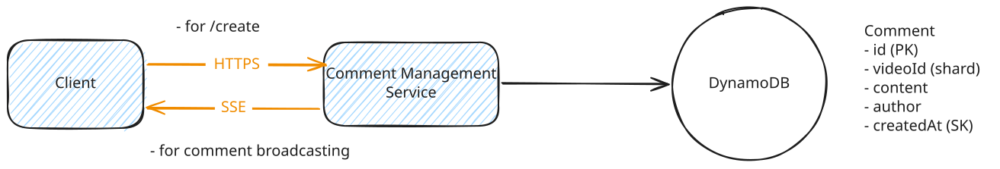
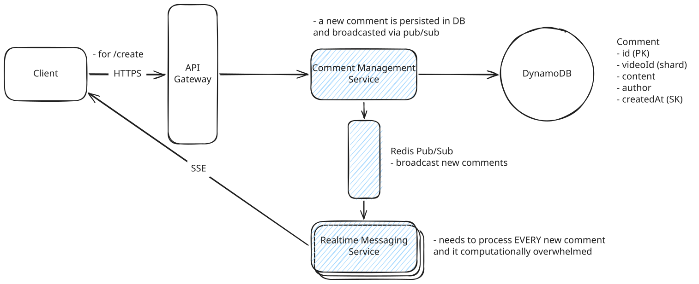
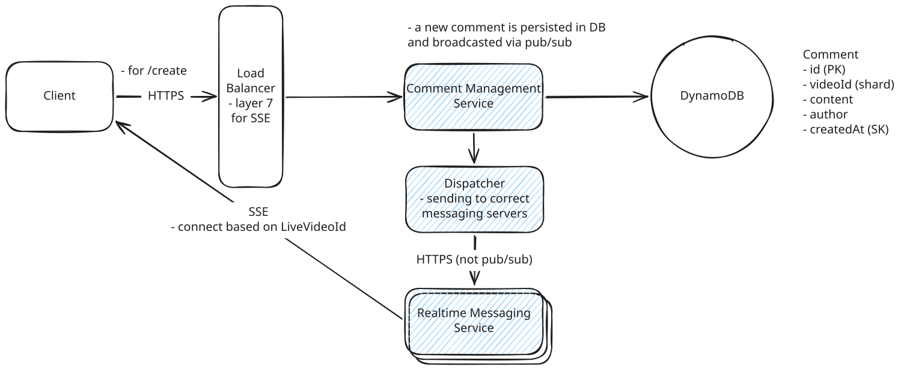
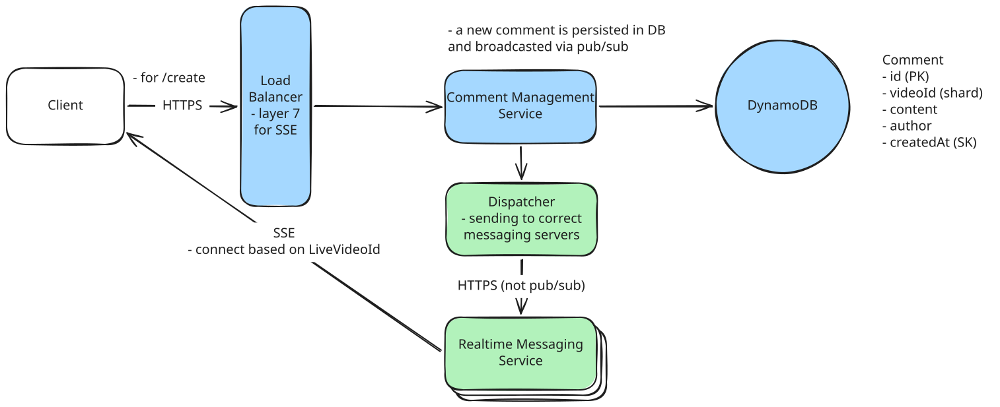

# FB Live Comments

---
## Deep Dives

### 1. Coments broadcasted to views in real-time

Instead of polling, we can use a push based model.

??? warning "Good Solution: Websockets"

    **Approach**

    Websockets are a two-way communication channel between a client and a server. The client opens a connection to the server and keeps it open. The server keeps a connection open and sends new data to the client without requiring additional requests.


    **Challenges**

    Websockets are basically the two-way communication channel. In our case, comment creation is a relatively infrequenty even while most viewers will be viewing/reading all comments.


??? success "Server Sent Events (SSE)"

    **Approach**

    SSE is a persistent connection that operates over standard HTTP, making it simpler to implement than WebSockets. The server can push data to the client in real-time, while client-to-server communication happens through regular HTTP requests.

    **Challenges**

    - Some proxies and load balancers lack support for streaming responses, leading to buffering issues that can be difficult to track down.
    - Browsers also impose limits on concurrent SSE connections per domain, which creates problems for users trying to watch multiple live videos simultaneously.




### 2. Scale to support millions of concurrent viewers

We need to maintain an open SSE connection for each viewer.

#### Part 1: Server Coordination

When we add more servers to handle the load, viewers watching the same live video may end up connected to different servers. 

- UserA is watching Live Video 1 and connected to Server 1
- UserB is watching Live Video 1 but connected to Server 2

Now imagine a new comment is posted on Live Video 1. If this comment request hits Server 1, it can easily send the comment to UserA since they're directly connected. But Server 1 has no way to send it to UserB, who is connected to Server 2. This is our key challenge.

??? warning "Good Solution: Naive Pub/Sub: Every Server Processes Every Comment"

    **Approach**

    Separate out the write and read traffic by creating Realtime Messaging Servers that are responsible for sending comments to viewers. Upon connecting to a Realtime Messaging Server, the client informs the server which live video it's watching. The server maintains a mapping in local memory:

    ``` json
    {
        "liveVideoId1": ["sseConnection1", "sseConnection2"],
        "liveVideoId2": ["sseConnection3", "sseConnection4"]
    }
    ```

    When a new comment is created, how does each server learn about it? The most common solution is pub/sub. The comment management service publishes a message to a channel whenever a new comment is created, and **all Realtime Messaging Servers subscribe to this channel**. They then send the comment to all viewers watching that live video.

    **Challenges**

    It's inefficient at scale. Each Realtime Messaging Server processes every comment across all live videos, even if none of its connected viewers are watching that video.

    


??? success "Great Solution: Partitioned Pub/Sub with Viewer Co-location"

    **Approach**

    Partitioning the comment stream into different channels. Each Realtime Messaging Server subscribes only to the channels it needs, determined by the viewers connected to it. we use a hashing function to distribute across N channels: `hash(liveVideoId) % N`.

    A Layer 7 load balancer can use **consistent hashing** based on the `liveVideoId` to route viewers of the same video to the same server. Alternatively, we can store a dynamic mapping of liveVideoId to server in a coordination service like Zookeeper, giving us more flexibility at the cost of operational complexity.


    **Challenges**

    The main challenge is managing the coordination between load balancing and pub/sub subscriptions. When a server's viewer composition changes, it needs to update its subscriptions accordingly.

    


??? success "Great Solution: Dispatcher Service instead of Pub/Sub"

    **Approach**

    Instead of servers subscribing to topics and receiving comments as they're published, we introduce a Dispatcher Service that directly routes each new comment to the correct Realtime Messaging Servers.

    When a new comment comes in, the comment management service asks the Dispatcher: "Which servers have viewers watching this video?" The Dispatcher maintains a dynamic map of which servers are responsible for which videos, kept in sync via heartbeats and registration protocols as servers join or leave. It then forwards the comment directly to those servers.

    Multiple Dispatcher instances can run in parallel behind a load balancer, all consulting the same coordination data (Zookeeper or etcd) for consistency.


    **Challenges**

    The main challenge is keeping the Dispatcher's mapping accurate during rapid changes, like a viral stream causing a sudden influx of viewers. The Dispatcher must refresh its view of the system frequently, and multiple Dispatcher instances need coordinated cache invalidation to prevent stale mappings.

    

#### Part 2: Mega-Streams

Imagine a mega-stream has 5,000 comments per second and the average comment is 4 words. When comments flow this fast, users can't meaningfully engage with individual comments.

??? warning "Good Solution: Show a Representative Subset"

    **Approach**

    We can sample the comment stream and only deliver a subset to each viewer.

    As comments arrive, we maintain a sampling rate that adjusts based on comment velocity. When comments flow at 100 per second, we might sample 50%. When they hit 5,000 per second, we sample just 1-2%.

    We can get clever with our sampling strategy too. Rather than pure random sampling, we can prioritize comments from users the viewer follows, comments getting reactions, or comments from verified accounts.

    **Challenges**

    While sampling reduces load significantly, we're still maintaining persistent SSE connections to millions of concurrent viewers and pushing updates in real-time.

??? success "Great Solution: CDN-Based Delivery with Periodic Snapshots"

    **Approach**

    Instead of pushing comments in real-time over SSE, we switch to a pull-based model using our existing CDN infrastructure.

    On the server side, we maintain a ring buffer of the most recent 100-200 comments for each mega-stream. Every second (or more frequently), we take a snapshot of this buffer and write it to Redis or directly to our CDN origin. The CDN distributes this snapshot globally, caching it at edge locations.

    On the client side, instead of maintaining an SSE connection, the app polls the CDN every second for the latest snapshot. When a new snapshot arrives, the client doesn't dump all the comments on screen at once (that would look janky). Instead, it smoothly animates the new comments, spacing them out over the polling interval to simulate a continuous stream.

    **Challenges**

    - The tradeoff is latency. We're now delivering comments with up to 1-2 seconds of delay rather than sub-200ms. But as established earlier, this doesn't matter for mega-streams because users can't meaningfully engage with individual comments anyway.
    - There's also the question of "read your own write" consistency. The client handles this locally by optimistically inserting the user's own comments into their feed immediately, independent of the CDN polling.
    - Another subtle complexity is the transition back to SSE when viewership drops. 

### 3. Handle client disconnections and ensure viewers don't miss comments

How to ensure users can catch up on what they missed without losing their place in the stream.

??? success "Great Solution: Last-Event-ID with Client-Side Tracking"

    **Approach**

    SSE has a built-in mechanism for handling reconnections through the `Last-Event-ID` header. When the browser detects a disconnection, it automatically reconnects and includes the last event ID it received. On the server side, when we see this header, we replay missed comments before resuming normal streaming.

    For more control, the client can also track the last comment ID locally (in localStorage for web, or app storage for mobile) and explicitly request catch-up via HTTP: `GET /comments/:liveVideoId?since={last_comment_id}&limit=100`. This lets us build a better UX around reconnection.

    **Challenges**

    If the user reconnects to a different Realtime Messaging Server than before (likely, given load balancing), that server needs access to the comment history.

---

### Final Design


