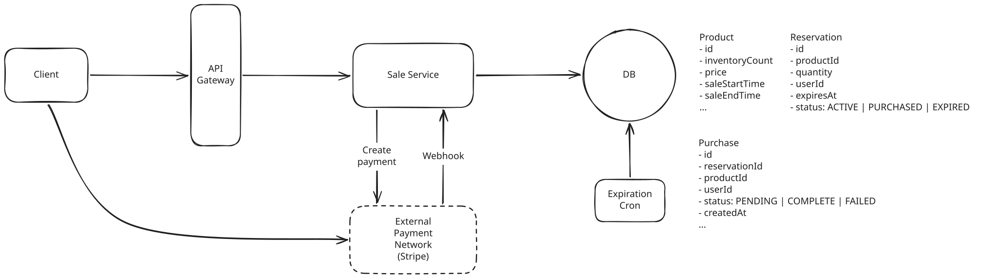

# Flash Sale

**What is a flash sale system?**

This problem zooms in on one particularly challenging part of an e-commerce system: selling a very limited amount of inventory under extreme demand.

Imagine Nike is releasing 10,000 pairs of a limited-edition shoe at noon. Tens of millions of users may attempt to purchase them within seconds.

**Key Focus Areas**

- **Purchase Process**: Waiting Room -> Reserve -> Purchase
- **Prevent read/write contention**: assign each count to a single row, `FOR UPDATE SKIP LOCKED`
- **Handlng traffic spike**: waiting room + admission control


---

## Functional Requirements

1. Users view the flash sale item.
1. Users reserve an available unit for a limited time while the sale is active.
1. Users who reserve a unit complete payment to purchase it.


---

## Non-Functional Requirements

1. Prevent overselling
1. Scale to 1M users and 10M RPS
1. Give users a fair opportunity to compete


---

## Core Entities

- **User**
- **Product**
- **Reservation**
- **Purchase**

---

## API Design


### 1. View sale item


``` bash
GET /products/:productId -> Product
```

### 2. Reserve unit

``` bash
POST /products/:productId/reservations -> Reservation
```

The Reservation the client gets back is a `reservationId`, the `productId` it covers, and an `expiresAt` timestamp, which is everything the client needs to show a countdown and then call the purchase endpoint.


### 3. Complete purchase

``` bash
POST /reservations/:reservationId/purchases -> Purchase
```

---

## High-Level Design




### 1. View sale item

1. The client sends a `GET /products/:productId` request.
1. The Sale Service queries the database for the corresponding product.
1. The product details, including the current `inventoryCount`, are returned to the client.

### 2. Reserve unit

1. The client sends `POST /products/:productId/reservations`.
1. The Sale Service checks that the product is on sale and has inventory remaining.
1. It creates a new row into the `Reservation` table with an expiration time(10 minutes).
1. It decrements the product's `inventoryCount`.
1. The reservation is returned to the client, giving the user to complete the purchase until `expiresAt`.

!!! warning

    Steps 2 through 4 have to be a single transaction. If not, two users can both read the same last unit as available and both make reservation for it, leading to the overselling issue.

To remove the expired reservations, let a simple cron job periodically queries the expired reservations, marks them as expired, and increments the product's `inventoryCount` to make those units available again. 

An expired unit might take a short period of time to return to inventory depending on how frequently the job runs, but that's fine for our initial design.

### 3. Complete purchase

1. The client sends `POST /reservations/:reservationId/purchases`.
1. The Sale Service verifies the reservation exists and has not expired.
1. It creates a `Purchase` with `status = PENDING`.
1. The Sale Service creates a Stripe `PaymentIntent` and returns the client secret to the client.
1. The client submits the payment details directly to Stripe and confirms the payment.
1. Stripe sends a webhook to the Sale Service with the result.
1. If the payment succeeds, the Sale Service marks the `Purchase` as `COMPLETE` and the `Reservation` as `PURCHASED`. If it fails, the `Purchase` is marked `FAILED` and the reservation remains active until it expires, giving the user a chance to retry.

