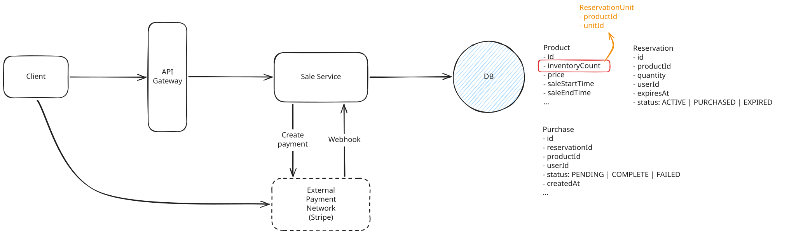
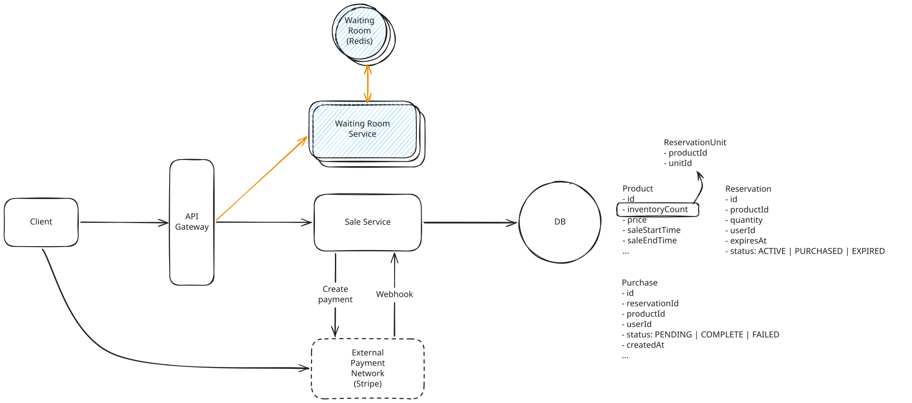
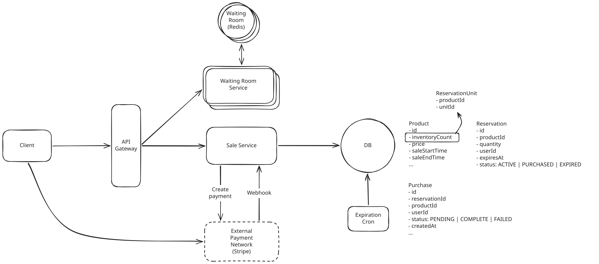

# Flash Sale

---
## Deep Dives

### 1. Prevent overselling(maintain consistency)

During the flash sale, potentially millions of reservation requests are all trying to update the same Product row. The database must serialize those writes because each decrement depends on the value produced by the previous one.

??? warning "Good Solution: Move Reservation Coordination to Redis"

    **Approach**

    Move our highly contended reservation state into Redis. We'll maintain a Redis counter for each product:

    ``` bash
    available:{productId} -> 10,000
    ```

    When a reservation request arrives, the Sale Service checks that the counter is greater than zero and decrements it.

    To add the unit back to the counter after expiring the reservation, we need a second data structure in Redis:

    ``` bash
    expirations:{productId}

    reservationA -> 12:10:03
    reservationB -> 12:10:07
    reservationC -> 12:10:12
    ```

    Because sorted sets are ordered by score, our existing cleanup job can efficiently find reservations whose expiration time has passed, remove them, and increment the inventory counter.

    Finally, decrementing the counter and recording the reservation can't be separate operations. We can execute the check, decrement, and reservation writes together in a small Lua script, which Redis executes atomically.

    **Challenges**

    - Our state is now split across two systems. Product and purchase data still live in our relational database, while available inventory and active reservations live in Redis. Redis is no longer just a cache. During the sale, it's part of our source of truth. That means we need to think carefully about durability, recovery, and how this state eventually reconciles with our persistent database.
    - Every reservation for this product still needs to update the same Redis counter. We've just moved that serialization somewhere much faster. If millions of users are allowed to hammer this key at once, Redis itself eventually becomes the bottleneck. 


??? success "Great Solution: Spread Contention Across Reservation Units"

    **Approach**

    Rather than moving our hot counter to Redis, we can fix the underlying data model so there is no single row for every reservation request to contend on.

    Instead of representing 10,000 available shoes with:

    ``` json
    inventoryCount = 10,000
    ```

    we create a pool containing one row for each reservable unit:

    ``` json
    ReservationUnit
    productId | unitId
    ------------------
    shoe-123  | 1
    shoe-123  | 2
    shoe-123  | 3
    ...
    shoe-123  | 10000
    ```

    Now each available shoe is represented by its own independently lockable row. When a user tries to reserve one, our transaction simply needs to claim any available row from this pool.

    The obvious way to do that would be:

    ``` sql
    SELECT unitId
    FROM ReservationUnit
    WHERE productId = shoe-123
    LIMIT 1
    FOR UPDATE SKIP LOCKED;
    ```

    - If it finds one available reservation unit, the database locks the selected row and prevents other transactions from claiming the same unit. 
    - Other transactions skip already locked units and try to grab other open units.

    1. Select one `ReservationUnit` using `FOR UPDATE SKIP LOCKED`.
    2. If no row is returned, the product is sold out.
    3. Delete the claimed `ReservationUnit`.
    4. Insert the corresponding `Reservation` with its `expiresAt` timestamp.
    5. Commit the transaction.

    When a reservation expires, the cleanup job marks it as expired and returns a row to the `ReservationUnit` pool. We'll improve that flow in the next deep dive.


    **Challenges**

    - The biggest tradeoff is that we're exchanging one compact counter for many database rows. For products with millions of inventory, **creating one row for every physical unit would become wasteful**. One way to address this is to maintain only a bounded pool of reservable rows and replenish it as the pool gets low rather than materializing the entire inventory upfront.
    - There is also still a limit to how much concurrent work our relational database can handle. **Tens of millions of users should still not be allowed to open database transactions simultaneously**. We'll handle that later when we introduce admission control.





### 2. How to efficiently release expired reservations?

In our high-level design, we handled this with a simple cron job. Every few seconds, it queried for active reservations whose `expiresAt` was in the past, marked them as `EXPIRED`, and returned a unit to the available `ReservationUnit` pool.

In a flash sale, where every unit matters, we need to **make that inventory available the moment the reservation expires**.


??? warning "Good Solution: Schedule Expiration Jobs"

    **Approach**

    For our 10-minute reservation window, we could use a delayed queue like Amazon SQS. When we create a reservation at 12:00:00, we also publish an `ExpireReservation(reservationId)` message with a 10-minute delay. SQS keeps the message hidden until roughly 12:10:00, at which point it becomes available for a worker to process. The worker performs a short database transaction that:

    1. Checks that the reservation is still `ACTIVE` and `expiresAt <= now`.
    1. Marks the reservation as `EXPIRED`.
    1. Returns a unit to the `ReservationUnit` pool.
    1. Commits the transaction.

    If the reservation has already been marked `PURCHASED` or `EXPIRED`, there is nothing left to do.


    **Challenges**

    - A large flash sale can create thousands or millions of reservations in a short window, which means we're also creating thousands or millions of delayed messages that become eligible for processing around the same time.
    - We're also not guaranteed that a job runs at the exact moment the reservation expires. Queues can back up, workers can fail, and messages can be retried.

??? success "Reclaim Expired Reservations on Demand"

    **Approach**

    Instead of pushing expired inventory back into the pool when a timer fires, we can reclaim it on demand when buyers actually need it.

    The normal reservation path doesn't change. We first try to claim an available `ReservationUnit` using `FOR UPDATE SKIP LOCKED`. 

    1. Try to claim an available `ReservationUnit` as usual.
    1. If none are available, One request acquires the reclamation lock for that productId.
    1. Find a batch of `ACTIVE`reservations where `expiresAt <= now`.
    1. Mark those reservations as `EXPIRED`.
    1. Keep one of the reclaimed units for this request and create its `Reservation`.
    1. Return the remaining `unitId`s to the `ReservationUnit` pool.
    1. Commit the transaction.
    1. It releases the lock.
    1. The waiting requests retry and spread across those newly available rows using `SKIP LOCKED`.

    What matters is that only one request does the relatively expensive reclamation work while everyone else stays on the normal reservation path.

    **Challenges**

    - The tradeoff is that the occasional reservation request now has to do more work. If the available pool is empty, one request may need to reclaim a batch of expired reservations before buyers can continue.
    - But the common path remains fast.


### 3. Handle millions of users arriving at once

Suppose load testing shows that our database can safely process around 10,000 reservation transactions per second. If hundreds of thousands or millions of users are allowed to attempt reservations at once, requests will still arrive faster than the database can process them. They'll pile up, latency will climb, and eventually requests will begin timing out or overwhelming the system.

Let's look at how we can introduce admission control.

??? warning "Good Solution: Rate Limit Reservation Requests"

    **Approach**

    rate limit reservation requests at the API Gateway. Reject anything above the threshold with a `429 Too Many Requests`.

    **Challenges**

    - We've protected the backend by pushing the pain directly onto the user.
    - Most users would receive a `429` and immediately retry. Those retries create another spike.

??? success "Great Solution: Add a Virtual Waiting Room"

    **Approach**

    When the flash sale begins, users first enter the waiting room rather than going directly to the reservation endpoint. The new Waiting Room Service records each user in Redis and returns an ID they can use to check their status while they wait.

    Meanwhile, an admission controller continuously lets users through at a controlled rate.

    1. The user joins the Waiting Room Service, which stores their queue entry in Redis.
    1. The client periodically polls a waiting-room status endpoint. While waiting, it gets a response like `WAITING`.
    1. The admission controller admits users by marking the associated entry as `ADMITTED` in Redis.
    1. Once admitted, the user receives a short-lived signed admission token.
    1. The client includes that token when it calls `POST /products/:productId/reservations`.
    1. The API Gateway validates the token before allowing the request to reach the Sale Service.


    The signed token ensures users can't bypass the waiting room and call the reservation endpoint directly. If a single Redis instance can't comfortably handle the waiting-room state and polling traffic, we can shard the waiting room across multiple Redis instances.

    **Challenges**

    - The main challenge is choosing the right admission rate.
    - The waiting room now decides who gets access to the scarce inventory and in what order.




### 4. How to make access to limited inventory fair?

We can open the waiting room before the sale begins but hold everyone there until noon. At noon, we randomly order everyone who is already waiting. Someone who joined at 11:55 has no advantage over someone who joined at 11:59:59. Once the sale has started, anyone new who arrives joins the back of the line in normal FIFO order.

We also need to stop individual users from taking multiple places in line. The waiting room should require an authenticated account and allow only one active queue entry per user for a given sale.

The signed admission token we introduced earlier ensures that users can't skip ahead once the ordering has been established.

Finally, if our waiting-room state is sharded across multiple Redis instances, the ordering still needs to be global.

An ordering value is a sortable number or key assigned when a user joins the waiting room. Before noon, give every waiting user a random value, such as `0.48392`, then admit users from smallest to largest value. After noon, assign each new user an increasing sequence number, such as `1`, `2`, and `3`, but place those values after all pre-sale users.

You could store a composite value like this.

``` bash
User A joined before noon  -> group = 0, order = 0.48392
User B joined before noon  -> group = 0, order = 0.91201
User C joined after noon   -> group = 1, order = 1
User D joined after noon   -> group = 1, order = 2
```

The admission controller sorts first by `group`, then by `order`. That admits A and B in random pre-sale order, then C and D in their arrival order. This works across Redis shards because each shard stores values that follow the same global sorting rule.

---

### Final Design


