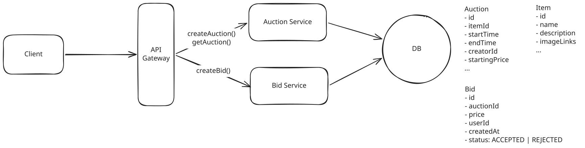

# Online Auction

**What is an online auction?**

An online auction service lets users list items for sale while others compete to purchase them by placing bids that top the current high bid until the auction ends, with the highest bidder winning the item.

**Key Focus Areas**

- Strong consistency for bids -> optimistic concurrency control
- Ensure fault tolerant and durable during the traffic spike -> Kafka
- Broadcast real-time updates -> SSE + Pub/Sub


---

## Functional Requirements

1. Users post an item for auction with a start price and end date.
1. Users bid on an item, where bids are accepted if they are higher than the current highest bid.
1. Users view an auction, including the current highest bid.


---

## Non-Functional Requirements

1. Maintain strong consistency for bids to ensure all users see the same highest bid.
1. Fault tolerant and durable. We can't drop any bids.
1. display the current highest bid in real-time so users know what they are bidding against.
1. Scale to support 10M concurrent auctions.


---

## Core Entities

- **Auction**: includes starting price, end date, the item being auctioned.
- **Item**
- **Bid**: includes amount, user, and the auction being bid on.
- **User**

---

## API Design


### 1. Post an auction


``` bash
POST /auctions -> Auction & Item
{
    item: Item,
    startDate: Date,
    endDate: Date,
    startingPrice: number,    
}
```

### 2. Place bids

For placing bids, we need a POST endpoint that takes the bid details and returns the created bid:

``` bash
POST /auctions/:auctionId/bids -> Bid
{
    Bid
}
```

### 3. View an auction

``` bash
GET /auctions/:auctionId -> Auction & Item
```

---

## High-Level Design




### 1. Post an auction

1. The client sends a `POST /auctions` request with the auction details.
1. The Auction Service validates the request and stores the auction and item data in the database.

### 2. Place bids

Bidding is the most interesting part of this problem, and where we will spend the most time in the interview.

1. Client sends a POST request to `/auctions/:auctionId/bids` with the bid details.
1. The Bidding Service validates incoming bids.
    - If the bid higher than the current highest, it stores the bid with `status = ACCEPTED`.
    - Else it stores the bid with `status = REJECTED`.
1. Bids are stored in the Bids table, linked to the auction by auctionId.

### 3. View an auction, including the current highest bid

We need to ensure that the current highest bid is at least reasonably up-to-date.

A GET request to `/auctions/:auctionId` which will return the relevant auction and item details to be displayed on the page. We can **simply poll for the latest maximum bid price every few seconds**. While imperfect, this ensures at least some degree of consistency and reduces the likelihood of a user being told their bid was not accepted when it actually was.
