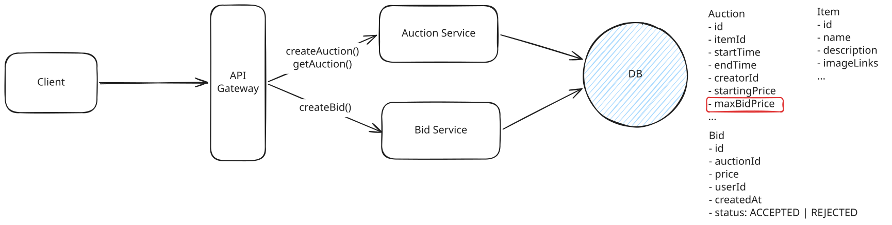
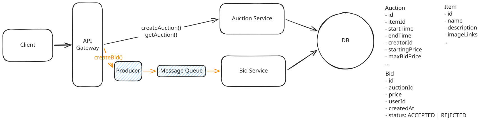
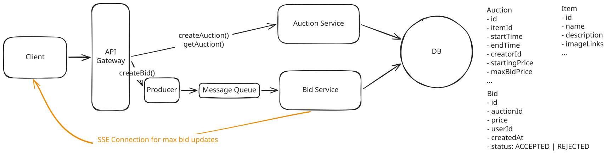
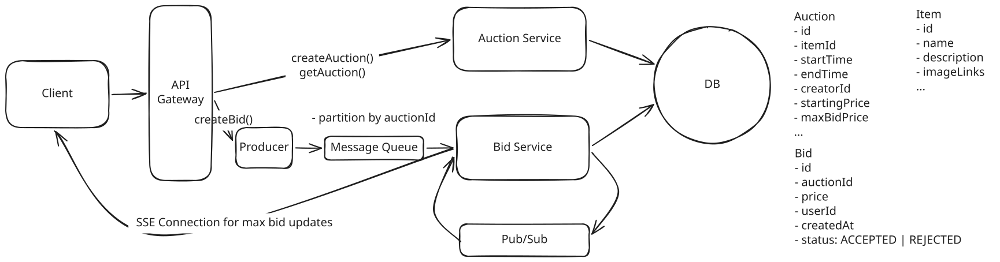

# Online Auction

---
## Deep Dives

### 1. Maintain strong consistency for bids

Example:

- The current highest bid is **$10**.
- **User A** decides to place a bid of **$100**.
- **User B** decides to place a bid of **$20** shortly after.

Without proper concurrency control, the sequence of operations might unfold as follows:

1. **User A's Read**: User A reads the current highest bid, which is $10.
1. **User A's Write**: User A writes their bid of $100 to the database. The system accepts this bid because $100 is higher than $10.
1. **User B's Read**: User B reads the current highest bid. Due to a delay in data propagation or read consistency issues, they still see the highest bid as $10 instead of $100.
1. **User B's Write**: User B writes their bid of $20 to the database. The system accepts this bid because $20 is higher than $10 (the stale value they read earlier).

This inconsistency occurs because **User B's bid of $20 was accepted based on outdated information**. Ideally, User B's bid should have been compared against the updated highest bid of $100 and subsequently rejected.

??? warning "Good Solution: Cache max bid externally"

    **Approach**

    We can cache the max bid in memory in something like Redis.

    1. **Read cache**: Read the max bid for the given auction from Redis.
    1. **Update cache**: If the new bid is higher, update the cache with the new max bid.
    1. **Write bid**: Write the bid to the database with a status of accepted or rejected.


    **Challenges**

    1. We need the cache read and cache write to happen atomically so we don't have a race condition like in our initial scenario. We can use a Lua script to ensure our read-modify-write (compare-and-set) sequence happens as one atomic operation.
    1. We need to make sure that our cache is strongly consistent with the database.


??? success "Great Solution: Cache max bid in database"

    **Approach**

    Add `maxBidPrice` column to `Auction` table. 

    1. Lock the auction row for the given auction (just one row)
    1. Read the max bid for the given auction from the `Auction` table.
    1. Write the bid to the database with a status of accepted or rejected.
    1. Update the max bid in the `Auction` table if the new bid is higher.
    1. Commit the transaction.

    We now only lock a single row and for a short duration. If we want to avoid pessimistic locking altogether, we can use **optimistic concurrency control (OCC)**.

    1. Read the auction row and get the current max bid (this is what is referred to as the 'version' with OCC)
    1. Validate that the new bid is higher than the max bid
    1. Try to update the auction row, but only if the max bid hasn't changed:
        ``` sql
        UPDATE auctions 
        SET max_bid = :new_bid 
        WHERE id = :auction_id AND max_bid = :original_max_bid
        ```
    1. If the update succeeds, write the bid record. If it fails, retry from step 1.





### 2. Ensure fault tolerant and durable

The best approach here is to introduce a durable message queue and get bids into it as soon as possible. This offers several benefits:

1. **Durable Storage**: When a bid comes in, we immediately write it to the message queue. Even if the entire Bid Service crashes, the bid is safely stored and won't be lost.
1. **Buffering Against Load Spikes**: The queue acts like a buffer, storing bids temporarily until the Bid Service can process them.
1. **Ordering Within an Auction**: Kafka guarantees message ordering within a single partition. By partitioning our topic by `auctionId`, all bids for the same auction land on the same partition and are processed in the order they were received.

While other solutions like RabbitMQ or AWS SQS would work, Kafka is well-suited for our needs because:

1. **High Throughput**: Kafka can handle millions of messages per second, perfect for high-volume bidding periods.
1. **Durability**: Kafka persists all messages to disk and can be configured for replication.
1. **Partitioning**: We can partition our queue by auctionId, ensuring that all bids for the same auction are processed in order while allowing parallel processing of bids for different auctions.





### 3. Display the current highest bid in real-time


??? warning "Good Solution: Long polling for max bid"

    **Approach**

    When a client wants to monitor an auction's current bid, they establish a connection that remains open until either the maximum bid changes or a timeout is reached (typically 30-60 seconds).

    The server holds the request open instead of responding immediately. When a new bid is accepted, the server responds to all waiting requests with the updated maximum bid. The clients then immediately initiate a new long-polling request, maintaining a near-continuous connection.

    **Challenges**

    - The server must maintain open connections for all clients watching an auction, which can consume significant resources when dealing with popular auctions.
    - We might face a "thundering herd" problem where all clients attempt to reconnect simultaneously after receiving an update.
    - If a bid comes in just after a client's previous long poll times out, they won't see the update until their next request completes.
    - Scaling becomes a challenge since each server needs to maintain its own set of open connections. If we want to scale horizontally by adding more servers, we need additional infrastructure like Redis or a message queue to coordinate bid updates across all servers.


??? success "Great Solution: Server-Sent Events(SSE)"

    **Approach**

    When a user views an auction, their browser establishes a single SSE connection. The server can then push new maximum bid values through this connection whenever they change.


    **Challenges**

    When a new bid comes in to Server A, there may be users watching that same auction who are connected to Server B. Without additional infrastructure, Server A has no way to notify those users about the new bid, since it only knows about its own connections.




### 4. Scale to support 10M concurrent auctions

#### Basic Throughput Assumptions

- 10M concurrent auctions and each auction has ~100 bids over its lifetime.
- If the average auction runs for a week, 
    - `10M auctions * 100 bids / 7 days = 140M bids per day`
    - `140M / ~100,000 seconds/day = 1,400 bids per second`
- To account for peak traffic, we should design for 10x this, or about **~15k bids per second** at peak.

#### Message Queue

Partition our Kafka topic by `auctionId` to maintain ordering guarantees per auction. At ~15K requests per second at peak, a modest number of Kafka partitions can handle this throughput comfortably.


#### Bid Service

By enabling auto-scaling, we can ensure that we're always running the right number of servers to handle the current load based on memory or CPU usage.

#### Database

- Auction is 1kb and Bid is 500 bytes.
- If the average auction runs for a week,
    - `10M * 52 = 520M auctions per year`
    - `520M * (1kb + (0.5kb * 100 bids per auction)) = 25 TB of storage per year`
- At ~15K writes per second during peak, we're pushing past what a single well-provisioned Postgres instance can handle.
    - Need to shard our database by auction ID so that we can spread the write load across multiple instances.

#### SSE

The problem is that when a new bid comes in, we need to broadcast it to all the clients that are watching that auction. If we have 10M auctions and 100M users, we could have 100M connections. 

The solution is Pub/Sub.  The way this works is simple: when Server A receives a new bid, it publishes that bid to the pub/sub system, essentially putting it on a queue. All other instances of the Bid Service are subscribed to the same pub/sub channel and receive the message. If the bid is for an auction that one of their current client connections is subscribed to, they send that connection the new bid data. 

---

### Final Design


