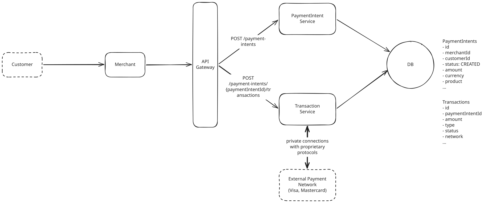

# Payment System

**What is Stripe?**

Payment processing systems like Stripe allow business (referred to throughout this breakdown as merchants) to accept payment from customers, without having to build their own payment processing infrastructure. Customer input their payment details on the merchant's website, and the merchant sends the payment details to Stripe. Stripe then processes the payment and returns the result to the merchant.

**Key Focus Areas**

- Idempotency: retries must never create a second charge.
- **Security**: public API key + secret key, iFrame
- Durability and auditability: every payment event is retained.
- Status update: usually through webhooks.
- Scale for peak payment traffic.

---

## Functional Requirements

1. Merchants initiate payment requests (charge a customer for a specific amount).
1. Users pay for products with cards.
1. The Payment system provides status updates for payments to merchants.
1. Merchants view status updates for payments(`PENDING`, `SUCCESS`, `FAILED`).


---

## Non-Functional Requirements

1. The system should be highly secure.
1. Guarantee **durability** and **auditability** with no transaction data ever being lost, even in case of failures.
1. Guarantee **transaction safety** and **financial integrity** despite the inherently asynchronous nature of external payment networks.
1. Scalable to handle high transaction volume (10,000+ TPS) and potentially bursty traffic patterns.


---

## Core Entities

- **Merchant**
- **PaymentIntent**: represents the merchant's intention to collect a specific amount from a customer and tracks the overall payment lifecycle from creation to completion.
- **Transaction**: represents a polymorphic money-movement record linked back to one PaymentIntent. Types include Charge (funds in), Refund (funds out), Dispute (potential reversal), and Payout (merchant withdrawal).

The relationship between PaymentIntent and Transaction is one-to-many.

---

## API Design


### 1. Merchants initiate payment requests

This will happen when a customer reaches the checkout page of a merchant's website.

``` json
POST /payment-intents -> paymentIntentId
{
  "amountInCents": 2499,
  "currency": "usd",
  "description": "Order #1234",
}
```

### 2. Users pay for products with cards.

When the customer enters payment details and click the Order button, the below request is made.

``` json
POST /payment-intents/{paymentIntentId}/transactions
{
  "type": "charge",
  "card": {
    "number": "4242424242424242",
    "exp_month": 12,
    "exp_year": 2025,
    "cvc": "123"
  }
}
```

!!! warning 

    In a real implementation, we'd never pass raw card details directly to our backend like this. We'd use a secure tokenization process to protect sensitive data. We'll get into the details of how we handle this securely when we get further into our design.

### 3. The Payment system provides status updates for payments

To get a real-time updates of the payment status, merchants provides the Payment system with a callback URL. When any payment events happen, the Payment system makes a call to that URL.

``` json
POST {merchant_webhook_url}
{
  "type": "payment.succeeded",
  "data": {
    "paymentId": "pay_123",
    "amountInCents": 2499,
    "currency": "usd",
    "status": "succeeded"
  }
}
```

### 4. Merchants view status updates for payments

``` bash
GET /payment-intents/{paymentIntentId} -> PaymentIntent 
```

The returned `PaymentIntent` would include the payment's current status (e.g., "pending", "succeeded", "failed") and any relevant details like error messages for failed payments.


---

## High-Level Design




### 1. Merchants initiate payment requests

1. A customer reaches the checkout page of the merchant's website.
1. The merchant makes an API call to the Payment system by sending `POST /payment-intents` with details like amount, currency, and description.
1. The PaymentIntent Service creates a new PaymentIntent record with an initial status `CREATED`.
1. The System generates a unique identifier for this PaymentIntent and returns it to the merchant as a response.

This PaymentIntent ID is crucial as it will be used in subsequent steps of the payment flow. The merchant will typically embed this ID in their checkout page or pass it to their client-side code where it will be used when collecting the customer's payment details.

### 2. Users pay for products with cards.

It's important to understand that payment processing is inherently asynchronous. Our system needs to handle this asynchronous nature by maintaining the state of each payment and transaction, and keeping merchants informed of status changes throughout the entire lifecycle.

1. The customer enters their credit card info on the merchant's website.
1. The merchant collects this data and sends it to `Transaction Service` along with the PaymentIntent ID(idempotency key).
1. The Transaction Service creates a transaction record with status `PENDING`.
1. The Transaction Service directly handles the payment network interaction:
    1. Connects to the appropriate payment network and sends the auth request.
    1. Receives the initial response (approval/decline).
    1. Updates the transaction record with the initial status.
    1. Continues to listen for callbacks from the payment netowrk over the secure private connection.
    1. When additional status changes occur, receives callbacks and updates records accordingly.
1. The Transaction Service updates the PaymentIntent status as the transaction progresses through its lifecycle.


### 3. The Payment system provides status updates for payments

After a payment is initiated and processed, merchants need a reliable way to determine its current status. 

- Merchants need to know when a payment succeeds to trigger fulfillment actions like shipping physical products, granting access to digital content, or confirming reservations.
- Likewise, they need to know when payments fail so they can notify customers or attempt alternative payment methods.


1. The merchant makes a `GET /payment-intents/{paymentIntentId}` request to retrieve the current status of a specific PaymentIntent.
1. The PaymentIntent Service queries the database for the current state of the PaymentIntent, and returns this info to the merchant.

While this polling approach works well for many use cases, it's not ideal for real-time updates or high-frequency status checks. In a deep dive later, we'll explore how webhooks can be implemented to provide push-based notifications.

