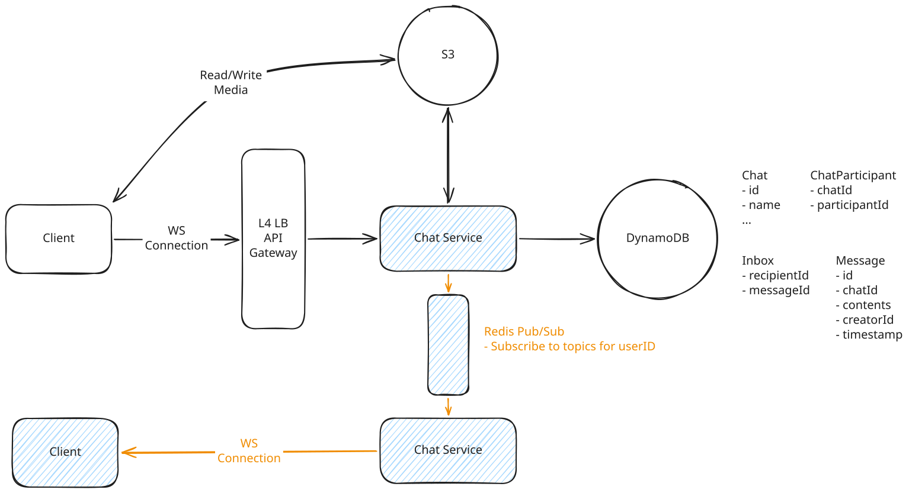
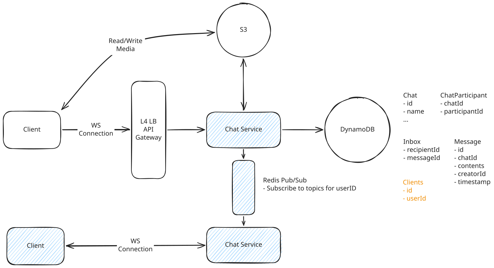

# WhatsApp

## Deep Dives

### 1. High throughput (billions of users)

**Issues to handle:**

- Expect 200M active users to be connected at any time. Whatsapp famously served 1-2M users per host. That means more servers are required.
- The sending and receiving users have to be connected to the same host.

??? failure "Bad Solution: Naively horizontally scale"

    Just adding some hosts won't work. We can't guarantee the Chat Server have the connections to each of the clients who needs to receive the message.

??? failure "Bad Solution: Keep a kafka topic per user"

    The idea here would be that we could keep our `Inbox` table as a Kafka topic. Then our Chat Servers will subscribe to the topic and deliver messages to the user. When a user connects to our Chat Server, they'd subscribe to the topic for their user ID. When we need to send a message to a given user we'd publish the message to the topic for that user. This message would be received by all the chat servers that have subscribed to that topic, and then the message could be passed on to the websocket connection for that user.

    - **Kafka is not built for billions of topics** and **carries significant overhead for each one** (order of 50kb per topic, so 50tb+ of storage for 1b users).

??? warning "Good Solution: Consistent Hashing of Chat Servers"

    Use ZooKeeper to always assign users to a specific Chat Server based on their user ID. When user A sends a message to user B in the different Chat Server, the Chat Server of the user A will find the user B's Chat Server endpoint by querying the user B's ID to the Chat Registry.

    - Each Chat Server will need to maintain connections with each other Chat Server which will require that we keep our Chat Servers big in size and small in number.
    - Increasing the number of Chat Servers requires careful orchestration of dropping connections so that users reconnect to other servers without triggering a thundering herd.

??? success "Great Solution: Offload to Pub/Sub"

    Redis Pub/Sub uses a very lightweight hashmap of socket connections to allow you to ferry messages to arbitrary destinations. With Pub/Sub you can create a subscription for a given user ID and then publish messages to that subscription which are received "at most once" by the subscribers.

    When publishing message:

    1. The sender POSTs `/sendMessage` with `chatId` and `message` to the Chat Server.
    1. Chat Server looks up participants for the given `chatId` and create `Message` and `Inbox` entry.
    1. Chat Server publishes a message to the topic for each participants ID in Pub/Sub.

    When a receiver is being connected to a Chat Server:

    1. That Chat Server is subscribing to the topic for that receiver, so the message is delivered to the Chat Server.
    1. The Chat Server delivers the message to the receiver over the established WebSocket connection.
    1. Once `ACK`ed by the receiver, Chat Server removes the relevant `Message` and `Inbox` entry.

    When a receiver is not connected to a Chat Server:

    1. The message are kept in the Pub/Sub topic pipeline.
    1. When the receiver is online, the Chat Server subscribes to the topic and gets the message.

    - The Pub/Sub implementation introduces additional latency but very small.

### 2. How to handle multiple clients for a given user?

**Clients table**

- `id`
- `userId`

**Inbox table**

- `recipientId` -> `recipientClientId`
- `messageId`

- need to create a new `Clients` table to keep track of clients by user id.
- need to update our `Inbox` table to be per-client rather than per-user.
- When we send a message, we'll need to send it to all of the clients for that user.
- On the pub/sub side, nothing needs to change. Chat servers will continue to subscribe to a topic with the `userId`.
- probably want to introduce some limits (3 clients per account) to avoid blowing up our storage and throughput.

### 3. What happens if the WebSocket connection fails?

How can we dectect the disconnection fast?

??? success "Great Solution: Application-Level Heartbeats"

    **Approach**

    The Chat Server sends periodic ping messages (every 10-30 seconds) over the WebSocket. The client must respond with a pong within a timeout (say, 5 seconds). If the client doesn't respond, the server closes the connection.

    **Challenges**

    - Heartbeats add overhead—with 200M connected users and a 10-second heartbeat interval, that's 20M ping/pong exchanges per second.
    - The heartbeats give you a guaranteed upper bound on detection time: if your heartbeat interval is 10s and timeout is 5s, you'll detect any dead connection within 15 seconds.

### 4. What happens if Redis fails to deliver a message?

How do we ensure re-connected clients quickly receive messages that Pub/Sub dropped?

??? warning "Good Solution: Periodic Polling"

    **Approach**

    Connected clients periodically poll the server for missed messages. Every 30-60 seconds, the client sends a "sync" request. The server checks the `Inbox` table for any undelivered messages and sends them down.

    **Challenges**

    **Adding load**: With 200M connected users polling every 30 seconds, that's ~7M queries/second just for sync checks. You can mitigate with longer intervals, but you're trading latency for load.

??? warning "Good Solution: Sequence Numbers per Chat with Gap Detection"

    **Apporach**

    Each message gets a monotonically increasing sequence number per chat. Clients track the last sequence number they've seen. If they receive message #5 but last saw #3, they know they missed #4 and request a re-sync.

    **Challenges**

    Gap detection only works when you do receive a message. If the chat goes quiet after the missed message, you won't detect the gap until the next message arrives. You still need polling as a backstop.

??? success "Great Solution: Piggyback Sequence on Heartbeats"

    **Approach**

    Combine heartbeats (from the previous section) with sequence numbers:

    1. **Global sequence per user**: Maintain a single incrementing counter per user. Every message to that user increments their sequence.
    1. **Include sequence in heartbeat**: When the server sends a heartbeat ping, include the user's current sequence number.
    1. **Client detects gaps**: If the client's local sequence is behind the server's, it immediately requests a sync.

    This gives you fast detection of missed messages (within one heartbeat interval) with minimal additional load because you're already sending heartbeats.

    **Challenges**

    The global sequence per user requires an atomic counter, which adds coordination. You can use Redis `INCR` commands, but it's another dependency. The benefit is that a single sequence catches all missed messages regardless of which chat they're in.
